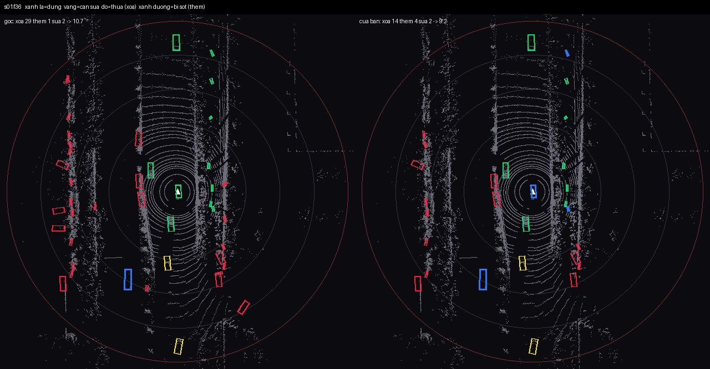

# Báo cáo Day 14 — Đào Bình An — 2A202603264

- Mã học viên dùng với `--student`: `2A202603264`
- `seed_tag` trong `frames_A.txt`: `82ac3100fd`
- Task tập A trên CVAT: `D14-2A202603264-A`

## 1. Dự đoán trước sweep (bước 5b)

Từ số đo của cấu hình gốc, tôi dự đoán tăng `score_thr` sẽ giúp giảm chi phí sửa trên tập A. Hiện có 48 hộp thừa, đóng góp 14.4 điểm trong tổng chi phí 21.9, nên việc lọc bớt các hộp có độ tin cậy thấp là hướng cần thử. Tôi cũng xét `min_points` để kiểm tra tác dụng của việc loại các hộp chứa quá ít điểm LiDAR.

Tôi chưa coi ngưỡng 0.5 là lựa chọn cuối cùng. Bản thử với `score_thr=0.5` và `min_points=5` đã giảm số hộp từ 97 xuống 55, nhưng số hộp bằng nhãn tham chiếu không có nghĩa là dự đoán đúng. Nếu lọc mất vật thể thật, mỗi hộp cần thêm lại có chi phí 1.0, lớn hơn chi phí xóa một hộp thừa là 0.3. Vì vậy, tôi sẽ chọn theo tổng chi phí thay vì chỉ nhìn số hộp còn lại.

Phần dự đoán này được viết sau khi đã có nhãn tham chiếu và bản thử ngưỡng 0.5, trước khi chạy sweep. Nội dung được AI hỗ trợ soạn từ số đo hiện có.

Lưu ý về trình tự: mục này chưa được commit và push trước khi chạy sweep, nên lịch sử Git không có bằng chứng đáp ứng yêu cầu bước 5b của đề.

## 2. Tập A: sửa tay và tune

Tập A của tôi gồm ba frame `s01f36`, `s02f13` và `s04f07`. Tôi chạy PointPillars với cấu hình gốc để tạo `pred_A.json`, sau đó đưa lên CVAT để kiểm tra và sửa nhãn. Sau khi kiểm tra xong, tôi lưu nhãn trên CVAT và xuất về file `ref_A.json`.

Khi so sánh dự đoán gốc với nhãn đã sửa, script ghi nhận 55 hộp tham chiếu và 97 hộp dự đoán trong phạm vi chấm điểm. Có 49 cặp hộp được ghép, trong đó 3 cặp cần sửa theo tiêu chí của script.

| Frame | Xóa | Thêm | Sửa | Chi phí |
|---|---:|---:|---:|---:|
| `s01f36` | 29 | 1 | 2 | 10.7 |
| `s02f13` | 11 | 3 | 1 | 6.8 |
| `s04f07` | 8 | 2 | 0 | 4.4 |
| **Tổng** | **48** | **6** | **3** | **21.9** |

Chi phí được tính theo công thức `0.3 × xóa + 1.0 × thêm + 0.5 × sửa`. Đây là số đo dựa trên mức chênh lệch giữa hai bộ nhãn, không phải thời gian hay số thao tác thực tế tôi đã thực hiện trên CVAT.

Trước khi chạy sweep, tôi cũng đã tạo một bản dự đoán thử với `score_thr=0.5` và `min_points=5`, lưu riêng thành `pred_A_strict.json`. Tổng số hộp giảm từ 97 xuống 55: frame `s01f36` còn 14 hộp, `s02f13` còn 21 hộp và `s04f07` còn 20 hộp. Số lượng này chưa cho biết các hộp còn lại có khớp nhãn tham chiếu hay không.

| Cấu hình | Xóa | Thêm | Sửa | Chi phí |
|---|---:|---:|---:|---:|
| Gốc | 48 | 6 | 3 | 21.9 |
| `best_config.json` | 27 | 10 | 2 | 19.1 |

Sweep thử 15 tổ hợp của `score_thr` từ 0.1 đến 0.5 và `min_points` bằng 0, 5, 10. Cấu hình được lưu trong `best_config.json` tăng `score_thr` từ 0.1 lên 0.4, giữ `min_points=0`. Cả ba mức `min_points` tại ngưỡng 0.4 đều cho chi phí 19.1, nên trong lưới thử này chưa thấy lợi ích bổ sung của việc tăng `min_points` tại ngưỡng được chọn.

Kết quả leave-one-out do script in ra:

```text
s01f36: cấu hình chọn {'score_thr': '0.4', 'min_points': '0'} → 9.2 (tốt nhất có thể 7.5)
s02f13: cấu hình chọn {'score_thr': '0.5', 'min_points': '0'} → 6.5 (tốt nhất có thể 5.8)
s04f07: cấu hình chọn {'score_thr': '0.5', 'min_points': '0'} → 5.2 (tốt nhất có thể 4.1)
```

Cấu hình được chọn thay đổi giữa ngưỡng 0.4 và 0.5 tùy frame bỏ ra. Chi phí kiểm tra đều cao hơn mức thấp nhất có thể trên chính frame đó, với chênh lệch lần lượt là 1.7, 0.7 và 1.1. Vì vậy, kết quả chưa cho thấy một ngưỡng ổn định cho mọi cảnh. Tôi dùng ngưỡng 0.4 vì nó đạt chi phí tổng thấp nhất trên toàn bộ tập A trong các cấu hình đã thử, đồng thời giữ lại nhiều vật thể thật hơn ngưỡng 0.5.

## 3. Trước/sau (bước 8)



Trong ảnh, bên trái là cấu hình gốc, bên phải là cấu hình đã chọn. Hộp xanh lá được giữ, vàng cần sửa, đỏ cần xóa và xanh dương là vật bị bỏ sót so với nhãn tham chiếu. Vòng đỏ đánh dấu phạm vi chấm điểm 50 m.

Chi phí tổng giảm từ 21.9 xuống 19.1, tương đương khoảng 12.8%. Số hộp cần xóa giảm từ 48 xuống 27, nhưng số vật cần thêm tăng từ 6 lên 10. Số hộp cần sửa giảm từ 3 xuống 2. Theo công thức của lab, phần xóa giảm 6.3 điểm, phần thêm tăng 4.0 điểm và phần sửa giảm 0.5 điểm, nên tổng chi phí giảm 2.8 điểm.

Kết quả phù hợp với hướng dự đoán tăng ngưỡng tin cậy để giảm hộp thừa, nhưng cũng cho thấy việc lọc phải có giới hạn. Khi tăng lên 0.5, số hộp cần xóa chỉ còn 14 nhưng số cần thêm tăng lên 14, khiến chi phí là 19.2, cao hơn một chút so với ngưỡng 0.4. Như vậy, ít hộp hơn không đồng nghĩa với ít công sửa hơn.

## 4. Tập B

Tập B gồm 12 frame được sinh cùng mã học viên và SEED với tập A. Tại thời điểm viết báo cáo này, chưa có `pred_B.json` và `ref_B.json`, nên tôi chưa có kết quả đánh giá trên tập B. Các kết quả tập A ở trên chưa đủ để khẳng định cấu hình sẽ giảm công sửa trên tập B.

Số đo cần lấy bằng lệnh:

```powershell
python scripts/pp_prelabel.py --data "$DataVF" --frames "d14_2A202603264/frames_B.txt" --config "d14_2A202603264/best_config.json" --gt "d14_2A202603264/ref_B.json"
```

| Xóa | Thêm | Sửa | Chi phí |
|---:|---:|---:|---:|
| Chưa có | Chưa có | Chưa có | Chưa có |

Chưa xác định được loại hộp tốn công sửa nhất trên tập B vì chưa hoàn thành bước sửa nhãn. Phần này cần cập nhật bằng số đo và quan sát thực tế sau khi hoàn thành đủ 12 frame.

## 5. Giới hạn

Tập A chỉ có ba frame, nên cấu hình có chi phí thấp trên tập này chưa chắc phù hợp với các cảnh khác. Tôi cần đọc thêm kết quả leave-one-out và xem kết quả trên tập B khi đánh giá cấu hình.

Model được huấn luyện trên KITTI với ba lớp Car, Cyclist và Pedestrian. Truck và Bus trong bài lab được suy ra bằng quy tắc kích thước, nên vẫn cần kiểm tra lại lớp bằng camera và point cloud.

Chi phí sửa dùng các trọng số cố định 0.3, 1.0 và 0.5. Vì chưa đo thời gian thao tác thực tế, tôi chỉ dùng số này để so sánh các cấu hình theo tiêu chí của bài lab, không quy đổi thành số giờ tiết kiệm.
